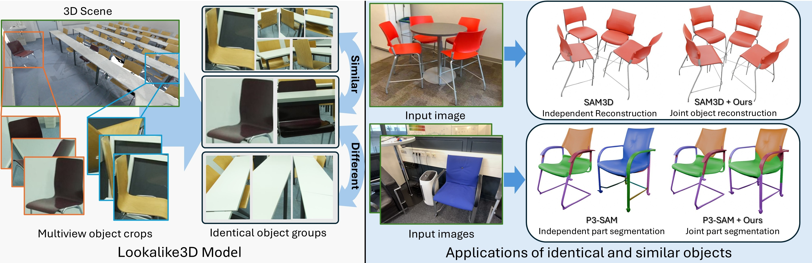

# Lookalike3D: Seeing Double in 3D

[<ins>Paper</ins>](https://arxiv.org/abs/2603.24713) | [<ins>Project Page</ins>](https://cy94.github.io/lookalike3d/) | [<ins>Video</ins>](https://www.youtube.com/watch?v=g6S7J0y_52U)



[<ins>Chandan Yeshwanth</ins>](https://cy94.github.io/), [<ins>Angela Dai</ins>](https://www.3dunderstanding.org/)

**NeurIPS 2026**

---

Joint 3D object reconstruction and part co-segmentation of identical and near-identical objects from multiview images. We introduce the **3DTwins** dataset — 76k manually annotated object pairs from ScanNet++ — and a multiview image transformer that achieves a 104% IoU improvement over baselines.

---

## Code and Data

Code and the 3DTwins dataset are coming soon. Stay tuned!

## Citation
If you find our work useful, please consider citing
```
@inproceedings{yeshwanth2026lookalike3d,
  title={Lookalike3D: Seeing Double in 3D},
  author={Yeshwanth, Chandan and Dai, Angela},
  booktitle={Advances in Neural Information Processing Systems},
  year={2026}
}
```
